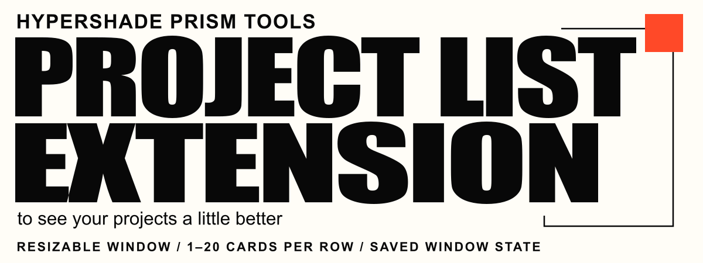
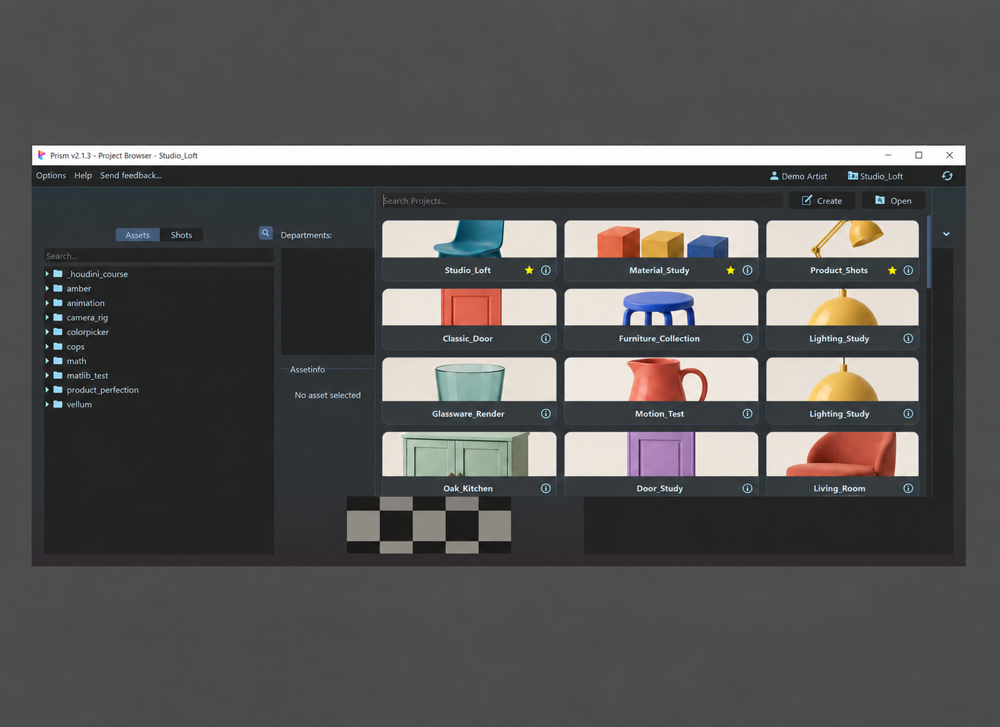
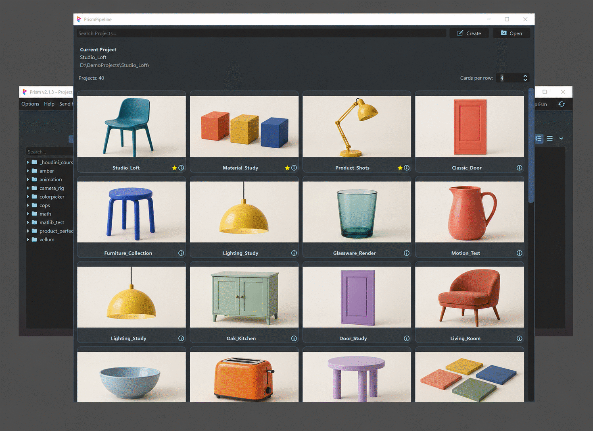
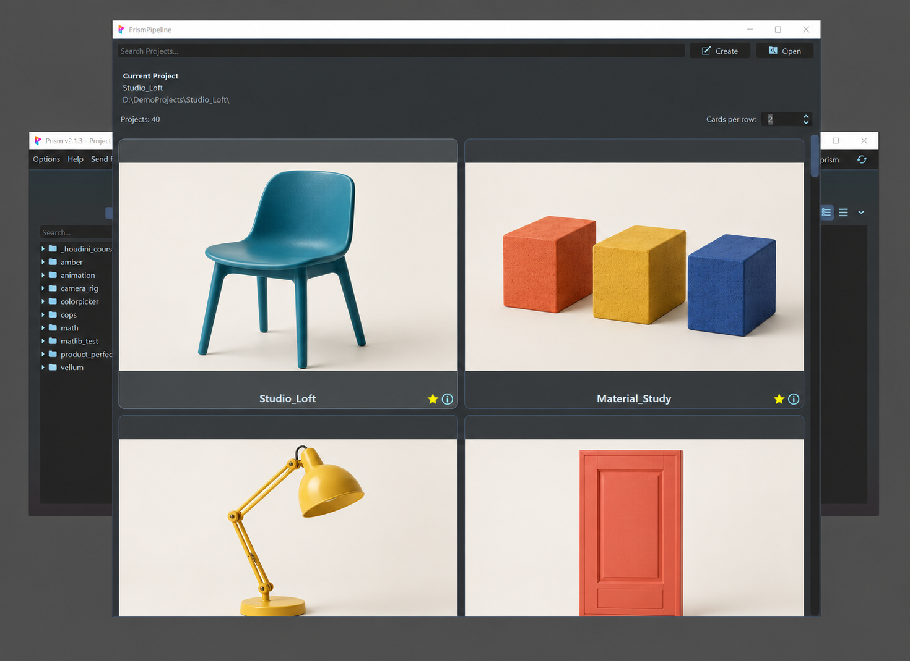

# Prism Project List Extension

**English** · [Magyar](README.hu.md)

A small Prism plugin that gives the project list more room to work: a resizable window, an adjustable card grid, and a clear view of the current project.


[Install](#install) · [Use](#use) · [Settings](#settings) · [Compatibility](#compatibility)

<br>

| Native Prism project list                                                                                        | Project List Extension                                                                                     |
| ------------------------------------------------------------------------------------------------------------------- | ---------------------------------------------------------------------------------------------------------------------- |
|  |  |
| Three columns with cropped thumbnails.                                                                              | A resizable window with an adjustable grid and full previews.                                                          |


## What it changes

| Feature          | What you get                                                           |
| ---------------- | ---------------------------------------------------------------------- |
| Resizable window | Resizable and movable window; its size and position are remembered.   |
| Adjustable grid  | Choose **1–20 cards per row**; cards resize together with the window.  |
| Full previews    | Thumbnails keep their proportions and remain visible without cropping. |
| Current project  | See the active project's name and path above the list.                 |
| List summary     | See the result count and current search text.                          |
| Scrollbar width  | Set a wider vertical scrollbar through a small JSON preference file.   |

This extends the **project list opened from the Project Browser**, not the Scenefiles, Products or Media views. Prism still handles project search, selection, favorites, creation and opening. Its installed source files are not edited.

## Install

1. Download or clone this repository.
2. Copy the inner **`hs_prism_project_list_ext_plugin`** folder to the location where you keep custom Prism plugins.
3. Open **Prism Settings → User → Plugins**, click the **Add existing plugin…** button (the folder icon), and select that folder. Keep **Auto Load** enabled for this plugin if you want it loaded on startup.
4. Restart Prism and any DCC application that loads Prism, then open the project list from the Project Browser.

The folder you select must contain `Scripts/Prism_hs_prism_project_list_ext_plugin_init.py`. Select the inner plugin folder, rather than the repository root or its `Scripts` folder.

## Use

- Open the project list using the current-project button in the Project Browser.
- Resize the window and choose **Cards per row** beside the project count: **1–20**, with **3** as the default.
- Search and open projects as usual. Close and reopen the list to restore its window size and position.

**Example: two cards per row**



## Settings

Preferences are stored in **`ProjectBrowserExt` inside Prism's user preferences folder**, independently of the plugin's installation location.

| File                       | Purpose                                           |
| -------------------------- | ------------------------------------------------- |
| `project_list_window.json` | Window size and position; saved automatically.    |
| `project_card_grid.json`   | Cards per row; saved when you change the control. |
| `appearance.json`          | Manually editable scrollbar width.                |

The first project-list opening creates `appearance.json` with this default:

```json
{
  "scrollbar_width": 18
}
```

Use an integer from **10 to 40**, or `null` to use the original Prism theme width. Save the file, then close and reopen the project list. Invalid values fall back to 18 without overwriting your file.

## Compatibility

| Environment                                             | Check status                                                                                |
| ------------------------------------------------------- | ------------------------------------------------------------------------------------------- |
| Windows · Prism **2.1.3** · PySide6 **6.11.1**          | Automated and isolated Prism/Qt checks passed.                                              |
| DCC and multi-monitor setup, DPI                    | Tested with different resolutions and DPI settings  |
| Linux | Expected to be compatible based on the code; not tested yet. |
| Other Prism versions, Qt bindings and operating systems | Not verified yet.                                                                           |

**Wayland:** When using Qt's native Wayland backend on Linux, restoring the saved window position may not work because the window system generally controls window placement. See the [Qt documentation](https://doc.qt.io/qt-6/application-windows.html).

No separate Python packages need to be installed into Prism. The plugin uses Python's standard library and the Prism/Qt environment.

## Troubleshooting

If the extension does not appear, check that the new plugin name is loaded, the correct folder was selected, and Prism/DCC was restarted after installation or an update.

Warnings and errors go to `ProjectBrowserExt/pbe_debug.log`. For detailed diagnostics, enable Prism's debug mode and a logging level that includes DEBUG. See the [installed plugin guide](hs_prism_project_list_ext_plugin/README.md).

For a bug report, include your Prism version, DCC/version, operating system, steps to reproduce, and a screenshot or relevant log excerpt.

## Development

The installable plugin is self-contained. See the [developer guide](development.md) for the module layout and logging diagnostics.

## License


[GNU GPL v3 only, with additional Prism/DCC linking permission](LICENSE).
